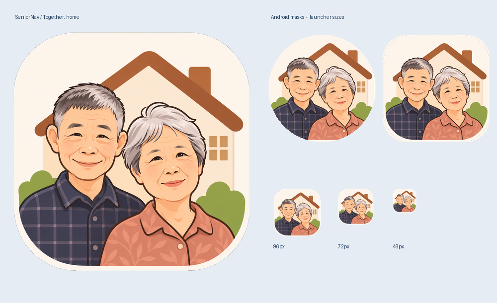

# SeniorNav

手机桌面名称：**回家**。

面向老年人的 Android 出行助手：从首页选择常用地点，查看地铁、公交或步行摘要，再打开百度地图导航。
家属提前设置目的地并核对入口，老人日常使用时无需输入地址。

当前版本 **0.1.8+9**，已实现五入口首页、更多地点、三种出行方式摘要、家属 PIN 设置及本地地点存储。
这是可试用初版；老人实际使用、户外定位、目的地入口与长期稳定性仍需验证。

## 图标

采用银发夫妻与小房子的暖色插画，适配旧版 Android 图标及自适应圆形、圆角方形裁切。



最终源图与生成方法见 [图标说明](app/artwork/README.md)。只保留最终素材与检查图，旧稿和独立预览不纳入版本控制。

## 构建与试用

准备 Flutter、Android SDK，以及已绑定包名和签名的百度 Android AK。
密钥通过环境变量 `BAIDU_ANDROID_AK` 或本机被忽略的 `.env.local` 提供。

```bash
python3 tools/build_app.py --release
```

产物：`app/build/app/outputs/flutter-apk/app-release.apk`。构建产物不进入 Git。
安装、首次家属设置及离线检查命令见 [App README](app/README.md)；验收记录和已知限制见
[初版试用说明](docs/m1/初版试用说明.md)。

## 请求限制与隐私

- 百度路线服务并发上限为 3，应用限制为最多 **1 条在途检索**；POI 与路线共用锁，串行执行，不自动重试。
- 不同时运行正式 App、SDK 探针或其他百度查询脚本；超时、离开页面不代表服务端请求结束。
- 家庭地点保存在手机本地，Android 云备份已关闭；真实住址、密钥、日志和定位截图不进入仓库。
- 当前代码已通过 139 项 Flutter 测试；原生并发闸门已有 8 项断言通过。
- “坐地铁”“坐公交”“走路”分别展示方案；每次查询按地铁优先、不坐地铁、步行顺序最多执行三次串行检索。地铁只展示全程地铁的方案，只有接驳方案时提示暂无地铁方案。
- 0.1.1 修复正式版初始化百度 SDK 时因 R8 删除原生入口而闪退的问题，构建时自动检查 7 个关键 JNI 类及方法。修复包已覆盖安装，用户后续确认已保存地点并返回首页。

## 文档入口

- [项目方案 v0.2](docs/plan/SeniorNav_项目初步方案_v0.2.md)
- [Android SDK 技术选型](docs/adr/0006-初版采用AndroidSDK薄通道.md)
- [真机导航测试清单](docs/m0/真机导航测试清单.md)
- [Git 提交与隐私规则](docs/GIT_COMMIT_RULES.md)
