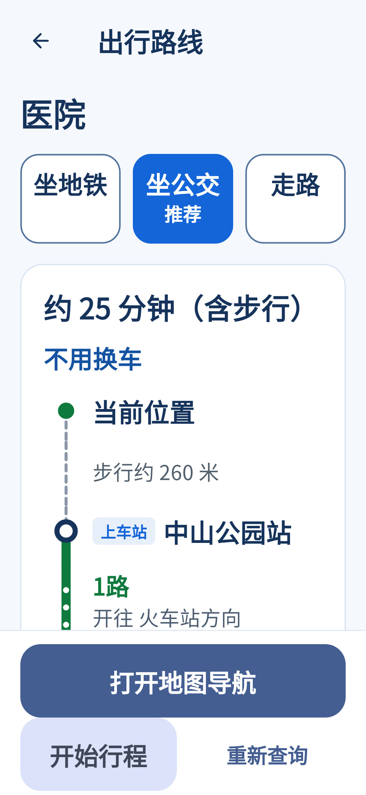
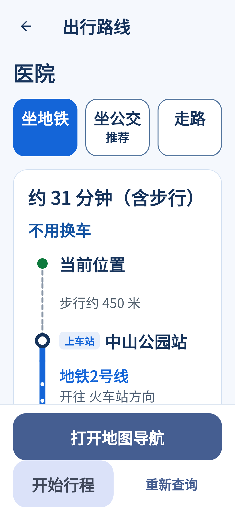
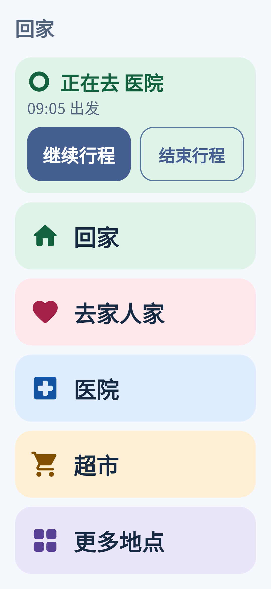

<p align="center">
  
</p>

<h1 align="center">回家 · SeniorNav</h1>

<p align="center">
  面向老年人的 Android 极简出行助手：<b>家属设好地点，老人一键出门。</b><br>
  不是独立导航软件，而是把「选地点 → 看大字路线 → 打开百度地图」压缩到最少步骤。
</p>

<p align="center">
  <a href="LICENSE"></a>
  
  
  
  <a href="https://github.com/renjunzhang/SeniorNav/releases"></a>
</p>

---

## 为什么做这个

老人用主流地图 App 出门，往往卡在「输入地址、看懂换乘、找到入口」这几步。
SeniorNav 把复杂度留给家属的一次性设置，把简单留给老人的每一次点击：
首页只有几个大按钮，路线用大字和竖向示意图讲清楚「走多远、在哪上车、坐几站、在哪下车」，
最后一键交给百度地图完成真正的导航。

**核心问题：老人能否在没有家属帮助的情况下，独立走完这四步？**

## 界面预览

> 以下截图全部为虚构示例数据，离线渲染，不含任何真实住址。

| 首页五入口 | 公交大字路线 | 纯地铁方案 | 进行中行程 |
| :---: | :---: | :---: | :---: |
|  |  |  |  |

## 功能特性

- **五入口首页**：回家 / 去家人家 / 医院 / 超市 / 更多地点，大按钮大字号，无需输入地址。
- **三种出行方式**：坐地铁 / 坐公交 / 走路，自动查询并给出推荐；地铁只展示全程地铁方案。
- **大字路线摘要**：约几分钟、含步行多少米、不用换车 / 换乘几次，配竖向线路示意图（上车站、坐几站、下车站）。
- **一键打开百度地图**：把目的地和出行方式交给百度地图完成导航，不做内嵌导航。
- **家属管理地点**：PIN 保护设置页，搜索并核对目的地入口；地点只存手机本地。
- **开始 / 结束行程**：首页横幅显示「正在去 ××」，可继续或结束，防误触连点。
- **断网可看上次路线**：路线缓存优先展示，重新查询才发起请求，并明确提示过期。

## 下载与安装

1. 到 [Releases](https://github.com/renjunzhang/SeniorNav/releases) 下载最新 `app-release.apk`。
2. 在老人手机上允许「安装未知来源应用」后安装（无需应用商店）。
3. 家属首次打开：同意隐私说明 → 设置 PIN → 添加并核对常用地点。
4. 之后老人日常只需点首页大按钮 → 看路线 → 打开地图导航。

覆盖安装即可升级，已保存地点保留。同一 APK 可装到多台家人手机。

## 隐私与安全

- 家庭地点、PIN、行程只保存在手机本地；Android 云备份已关闭。
- 仓库与截图不含真实住址、坐标、密钥或定位日志；示例数据均为虚构。
- 百度 Android AK 通过环境变量或本机被忽略的 `.env.local` 注入，不进入 Git。
- 严格遵守百度并发纪律：最多 **1 条在途检索**，POI 与路线共用串行锁，不自动重试。

## 开发者构建

准备 Flutter、Android SDK，以及已绑定包名与签名 SHA1 的百度 Android AK。

```bash
# 密钥二选一：环境变量，或本机被 git 忽略的 .env.local
export BAIDU_ANDROID_AK=<你的AK>
python3 tools/build_app.py --release
```

产物：`app/build/app/outputs/flutter-apk/app-release.apk`（构建产物不进入 Git）。

```bash
cd app
flutter analyze
flutter test          # 150 项测试
```

安装、首次家属设置与离线检查命令见 [App README](app/README.md)；
验收记录与已知限制见 [初版试用说明](docs/m1/初版试用说明.md)。

## 文档入口

- [项目方案 v0.2](docs/plan/SeniorNav_项目初步方案_v0.2.md)
- [Android SDK 技术选型](docs/adr/0006-初版采用AndroidSDK薄通道.md)
- [真机导航测试清单](docs/m0/真机导航测试清单.md)
- [Git 提交与隐私规则](docs/GIT_COMMIT_RULES.md)
- [图标说明](app/artwork/README.md)

## 现状与限制

当前版本 **0.1.10+11**，为可试用初版：五入口首页、三种出行方式、家属 PIN、本地存储、
行程管理均已实现并通过 150 项测试。老人实际使用、户外定位、目的地入口准确性与长期稳定性
仍需真机验证；暂不包含内嵌导航、实时到站提醒与完整离线导航。

## 开发贡献

- **作者 / 维护**：zhang renjun（[@renjunzhang](https://github.com/renjunzhang)）——需求、真机验收与隐私把关。
- **AI 辅助开发**：Qwen4-Max-Preview + Qoder——代码实现、测试与文档协作。

欢迎通过 Issue / PR 参与改进；提交前请阅读 [Git 提交与隐私规则](docs/GIT_COMMIT_RULES.md)。

## 许可证

[MIT](LICENSE) © 2026 zhang renjun